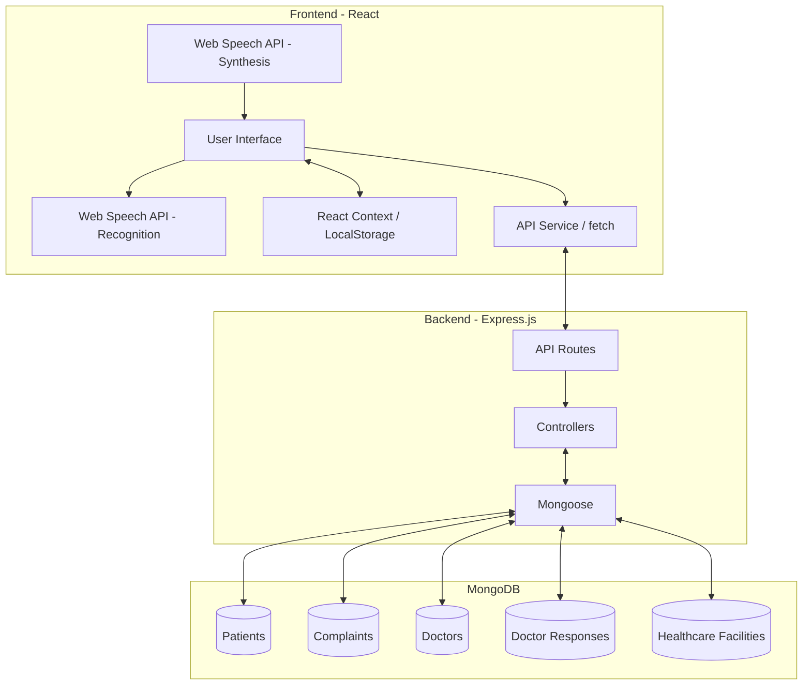
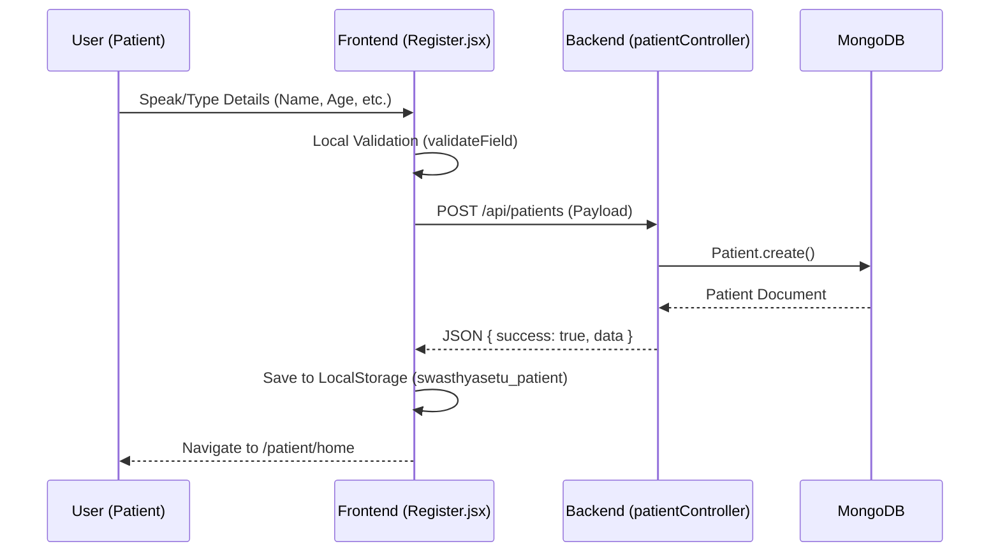
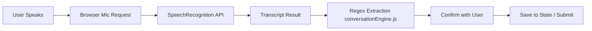
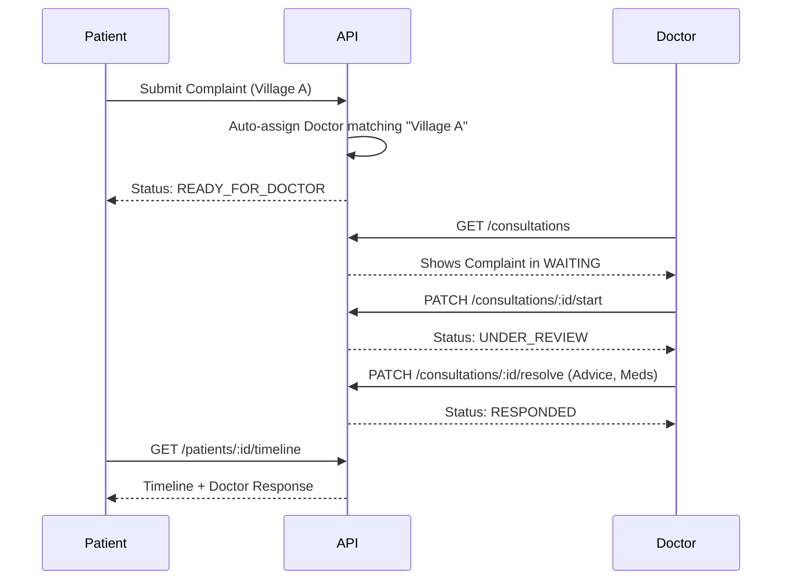
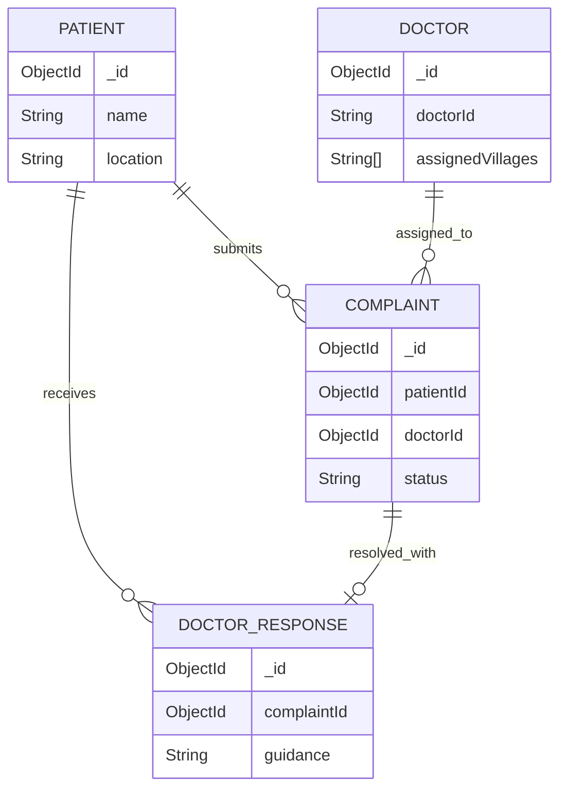

# SwasthyaSetu - Technical Documentation & Audit

## 1. Project Overview
SwasthyaSetu is a Smart Rural Health Management System designed to connect rural patients with healthcare services through voice interaction, multilingual accessibility, doctor consultations, and nearby healthcare facility information. The system focuses on accessibility, allowing users with lower digital literacy to interact via native browser speech recognition and synthesis. 

## 2. Verified Technology Stack
*   **Frontend**: React.js, Tailwind CSS, Vite
*   **Backend**: Node.js, Express.js
*   **Database**: MongoDB, Mongoose
*   **State Management**: React Context (`PatientContext`, `LanguageContext`), LocalStorage
*   **Browser APIs**: 
    *   `SpeechRecognition` (or `webkitSpeechRecognition`) for Voice-to-Text.
    *   `SpeechSynthesis` for Text-to-Speech (TTS).
*   **Architecture Pattern**: RESTful Client-Server architecture.

## 3. System Architecture
The application follows a standard MERN-like stack (without Redux, using Context instead).
*   **Frontend (React)**: Handles user interfaces, microphone inputs, TTS playback, and state persistence via LocalStorage. It communicates with the backend via REST API calls.
*   **Backend (Express.js)**: Exposes RESTful endpoints, handles business logic (like doctor assignment), and connects to MongoDB.
*   **Database (MongoDB)**: Stores structured data (Patients, Complaints, Doctors, Doctor Responses, Facilities).

### Architecture Diagram

## 4. Registration and Authentication

### Patient Flow
Patients do not have a traditional username/password login.
1.  **Registration**: In `Register.jsx`, the patient provides their Name, Age, Gender, Location, and Phone. 
2.  **API Call**: Sent to `POST /api/patients`.
3.  **Session**: The frontend stores the returned patient object in `localStorage` under the key `swasthyasetu_patient`. 
4.  **Login**: Returning patients are automatically "logged in" by retrieving the data from `localStorage` in `PatientContext.jsx`.

### Doctor Authentication Flow
Doctors have a secured login.
1.  **Login Form**: `DoctorLogin.jsx` takes Doctor ID and Password.
2.  **API Call**: Sent to `POST /api/doctor/login`.
3.  **Backend Verification**: `doctorAuthController.js` verifies the credentials against the `Doctor` collection.
4.  **Session/Auth**: No JWT is used. For prototyping, the frontend stores the doctor object in `localStorage` (`swasthya_doctor`).
5.  **Protected Routes**: API requests include `x-doctor-id` in the headers (`api.js`). The backend middleware `protectDoctor` verifies this header before allowing access to consultation routes.

### Sequence Diagram: Patient Registration

## 5. Voice Input Implementation
Voice input is critical for rural accessibility. 
*   **API Used**: Native Browser `SpeechRecognition` API (via `useSpeechRecognition.js` hook).
*   **Initialization**: The hook checks `window.SpeechRecognition || window.webkitSpeechRecognition`. 
*   **Permissions**: Handled natively by the browser when `recognition.start()` is called. If denied, the `onerror` callback handles the `not-allowed` error.
*   **Language Configuration**: `recognition.lang` is dynamically set based on the selected language in `LanguageContext` (e.g., `hi-IN`, `gu-IN`).
*   **Execution**:
    1.  The app prompts the user and calls `startListening()`.
    2.  `recognition.onresult` captures speech (`transcript`).
    3.  `Register.jsx` waits for the speech to finish (`recognition.onend`), then calls `handleTranscript(transcript)`.
    4.  **Crucial Bug Fix in Code**: The AI scrubs its own spoken prompt from the transcript to prevent processing its own TTS output.
    5.  `conversationEngine.js` uses Regex to extract data (Age, Gender, Phone, etc.) from the localized transcript.
*   **Limitations**: It strictly relies on browser support and requires internet connectivity to function (Chrome's speech engine requires internet).

## 6. Multilingual Support Implementation
The app implements a **localized UI and TTS system**, but **does NOT perform automatic machine translation** of user inputs or doctor responses.
*   **Languages Supported**: Hindi (`hi-IN`), English (`en-US`), Gujarati (`gu-IN`), Telugu (`te-IN`), Marathi (`mr-IN`).
*   **Mechanism**: A manual dictionary object in `LanguageContext.jsx` maps keys to localized strings.
*   **UI Translation**: The `t(key)` function retrieves the label for the current language.
*   **Speech Language**: `SpeechRecognition` and `SpeechSynthesisUtterance` use the locale string (e.g., `hi-IN`).
*   **Limitations**: The doctor's advice is stored in whatever language the doctor typed it. The system does *not* translate the doctor's Hindi text into Telugu if the patient is Telugu. It relies entirely on the TTS engine's ability to read the characters provided. 

## 7. Text-to-Speech Implementation
TTS allows patients to hear doctor responses.
*   **API Used**: `window.speechSynthesis` and `SpeechSynthesisUtterance` (via `useSpeechSynthesis.js`).
*   **Voice Selection**: Matches the `language` state from `LanguageContext`.
*   **Flow**: 
    *   In `Advice.jsx`, a `ListenButton` (with a `large` prop for accessibility) is rendered.
    *   Clicking it passes the text to the `speak(text)` function.
    *   The engine calculates an `estimatedDuration` (accounting for character length and punctuation pauses) as a fallback mechanism for browsers (like Android Chrome) where the `onend` event fails to fire.
*   **Limitations**: Pronunciation accuracy is heavily dependent on the device's installed TTS engines.

## 8. Patient Complaint Lifecycle
1.  **Submission**: Patient speaks/types their complaint via `Complaint.jsx`. 
2.  **Creation**: `POST /api/complaints`. The backend creates a complaint with status `READY_FOR_DOCTOR`.
3.  **Assignment**: Inside `complaintController.js`, the backend checks the patient's `location` against the `assignedVillages` array of all doctors. The first match becomes the `doctorId`. (If no match, `doctorId` is null).
4.  **Doctor Review**: The doctor opens the dashboard, clicks a waiting patient. A `PATCH /api/doctor/consultations/:id/start` updates the status to `UNDER_REVIEW`.
5.  **Resolution**: Doctor submits guidance/medicines. A `PATCH /api/doctor/consultations/:id/resolve` creates a `DoctorResponse` record and updates the complaint status to `RESPONDED`.
6.  **Patient Retrieval**: The patient checks `History.jsx` or `Advice.jsx`. `getTimeline` API aggregates complaints and responses into a chronological list.

## 9. Database Schema and Relationships
The system uses Mongoose schemas.
*   **Patient**: `name`, `age`, `gender`, `location`, `phone`.
*   **Doctor**: `name`, `doctorId` (unique login ID), `passwordHash`, `assignedVillages` (Array of Strings).
*   **Complaint**: `patientId` (Ref: Patient), `doctorId` (Ref: Doctor), `originalStatement`, `problem`, `status` (Enum: READY_FOR_DOCTOR, UNDER_REVIEW, RESPONDED), `inputMethod`, `language`.
*   **DoctorResponse**: `complaintId` (Ref: Complaint - Unique), `patientId` (Ref: Patient), `guidance`, `precautions`, `medicines`, `followUp`.
*   **HealthcareFacility**: `name`, `type`, `address`, `village`, `latitude`, `longitude`, `isEmergencyAvailable`.

## 10. API Documentation (Express Routes)
*   **Patient Endpoints (`/api/patients`)**
    *   `POST /`: Create a new patient.
    *   `GET /:id`: Retrieve a patient.
    *   `GET /:patientId/timeline`: Aggregate complaints, responses, and documents into a sorted timeline.
*   **Complaint Endpoints (`/api/complaints`)**
    *   `POST /`: Submit a new complaint (triggers auto-assignment logic).
    *   `GET /patient/:patientId`: Get all complaints for a patient.
*   **Doctor Endpoints (`/api/doctor`)**
    *   `POST /login`: Authenticate doctor.
    *   `GET /consultations`: Fetch complaints assigned to `req.doctorId`.
    *   `PATCH /consultations/:id/start`: Change complaint status to `UNDER_REVIEW`.
    *   `PATCH /consultations/:id/resolve`: Create a `DoctorResponse` and update status to `RESPONDED`.
*   **Facilities (`/api/facilities`)**
    *   `GET /`: Returns nearby facilities. (Uses mock data insertion if DB is empty).

## 11. Healthcare Facilities and Emergency Features
*   **Facilities**: Implemented via `HealthcareFacilities.jsx` and `facilityController.js`. The database has a `HealthcareFacility` model. If the DB is empty on load, it auto-seeds 3 mock facilities in Kanpur. No real-time geolocation/Haversine math is implemented; it simply returns the list.
*   **Emergency Help**: `EmergencyHelp.jsx` provides static buttons that utilize the `tel:` URI scheme (e.g., `tel:108` for Ambulance, `tel:100` for Police) to launch the device's native phone dialer.

## 12. Security and Data Persistence
*   **Authentication**: Uses custom header `x-doctor-id` for doctor routing. This is a prototype-level security measure (no JWT). Passwords exist in the schema but standard hashing/validation is minimal/mocked in the current scope.
*   **Data Persistence**: Uses MongoDB for backend persistence. The frontend heavily relies on `localStorage` to keep the patient session active (`swasthyasetu_patient`) across browser reloads.

## 13. Deployment Architecture
*   **Configuration**: Requires `.env` file containing `PORT`, `MONGODB_URI`, and `NODE_ENV`.
*   **Frontend**: Built with Vite. Dev command: `npm run dev`. Connects to API via `import.meta.env.VITE_API_URL` fallback to `http://localhost:5000`.
*   **Backend**: Node.js/Express. Run with `node server.js` or `npm run dev` (nodemon).
*   **CORS**: Enabled globally on the backend via the `cors` package to allow cross-origin requests from the Vite dev server.

## 14. Known Limitations and Missing Features
*   **No Actual AI or ML**: While it feels like an AI assistant, it uses Regex (in `conversationEngine.js`) to extract entities (age, gender, etc.) from standard speech transcripts.
*   **No Auto-Translation**: If a patient speaks Telugu, the doctor sees Telugu text. The doctor must respond in a language the patient understands.
*   **Basic Auth**: The system uses `localStorage` IDs instead of secure HttpOnly cookies or JWTs. 
*   **Offline Support**: Does not work offline due to reliance on Google Chrome's cloud-based Speech Recognition API and MongoDB cloud/local network fetching.

---

## 15. Hackathon Viva Questions and Answers

**Q1: What is your technology stack and why did you choose it?**
*   **Answer**: We used the MERN stack (MongoDB, Express, React, Node.js) with TailwindCSS. We chose it because React is excellent for building dynamic, single-page UI components quickly, while Node/Express allows for rapid API development. 
*   **Hindi**: Humne MERN stack aur React use kiya hai kyunki ye fast single-page apps banane ke liye sabse best hai.
*   **Technical Context**: Uses Vite for frontend tooling and Mongoose for DB modeling.

**Q2: How does voice input work technically?**
*   **Answer**: We leverage the browser's native `SpeechRecognition` API (Web Speech API). When the user clicks the mic, it captures audio, sends it to the browser's speech engine, and returns a text transcript which we process using Regex to extract data like age and location.
*   **Hindi**: Hum browser ka Web Speech API use karte hain jo aawaz sunkar text mein convert karta hai.
*   **Technical Context**: Uses `window.SpeechRecognition` or `webkitSpeechRecognition`.

**Q3: How do you handle multiple languages?**
*   **Answer**: We maintain a localized dictionary file for UI labels (using React Context). For voice, we dynamically pass the selected locale string (e.g., `hi-IN` or `te-IN`) to both the `SpeechRecognition` and `SpeechSynthesis` browser APIs.
*   **Hindi**: Humne ek dictionary banayi hai UI ke liye, aur browser API ko batate hain ki user kis bhasha mein bol raha hai (jaise hi-IN).
*   **Technical Context**: Managed in `LanguageContext.jsx`. It does *not* do machine translation of the actual medical advice.

**Q4: How does the doctor's response reach the patient?**
*   **Answer**: The doctor submits a form which hits a PATCH endpoint. This creates a `DoctorResponse` document in MongoDB tied to the `Complaint` ID. The patient's app polls or fetches the timeline API, which joins the complaint and response data.
*   **Hindi**: Doctor form submit karta hai jo database me save hota hai, aur patient ka app us data ko fetch karke screen par dikhata hai.
*   **Technical Context**: `createDoctorResponse` API in `doctorController.js`.

**Q5: How do you convert text into speech?**
*   **Answer**: We use the native `SpeechSynthesisUtterance` API. We pass the doctor's response text to it, apply the user's preferred language, and the browser's built-in TTS engine reads it out loud.
*   **Hindi**: Browser ke andar jo Text-to-Speech engine hota hai, hum text usko dete hain aur woh bolkar sunata hai.
*   **Technical Context**: Handled in `useSpeechSynthesis.js`. We calculate an `estimatedDuration` to handle browser bugs where the `onend` event fails.

**Q6: How is the doctor assigned to a patient?**
*   **Answer**: It is handled automatically on the backend. When a complaint is created, the system compares the patient's `location` string against the `assignedVillages` array of registered doctors. It assigns the complaint to the first matching doctor.
*   **Hindi**: System patient ke gaon ka naam check karta hai aur jis doctor ki duty us gaon mein hoti hai, complaint usko assign kar deta hai.
*   **Technical Context**: Handled dynamically in `complaintController.js` inside `createComplaint`.

**Q7: How do you secure patient information?**
*   **Answer**: Currently, this is a prototype, so security is basic. Doctors access their portal using a custom ID passed in headers. In a production environment, we would upgrade this to JWT tokens, HTTPS, and encrypted databases.
*   **Hindi**: Abhi ye prototype hai isliye security basic hai, aage chal kar hum JWT aur proper encryption use karenge.
*   **Technical Context**: Custom `protectDoctor` middleware in `doctorRoutes.js` checking `x-doctor-id`.

**Q8: Does the application work offline?**
*   **Answer**: No, the core functionality (Speech Recognition) relies on the browser's cloud-based speech engines, and the app needs internet to reach the backend database.
*   **Hindi**: Nahi, speech recognition aur database ke liye internet ki zarurat padti hai.
*   **Technical Context**: Web Speech API typically routes audio to Google/Apple servers depending on the OS/Browser. 

**Q9: What happens if speech recognition fails?**
*   **Answer**: If the API fails to understand, the regex extraction fails, or permissions are denied, the system gracefully falls back to offering manual text input forms. 
*   **Hindi**: Agar aawaz samajh nahi aati ya mic kaam nahi karta, toh user type karke manual form bhar sakta hai.
*   **Technical Context**: Handled via `MANUAL_FALLBACK` state in `Register.jsx`.

**Q10: What are the current technical limitations?**
*   **Answer**: The system lacks real-time machine translation (meaning doctors must reply in the patient's language) and lacks WebSockets for real-time live chat updates.
*   **Hindi**: Abhi system khud se bhasha translate nahi karta, aur real-time chat ke liye WebSocket nahi hai.
*   **Technical Context**: Future scope involves adding Google Translate API and Socket.io.