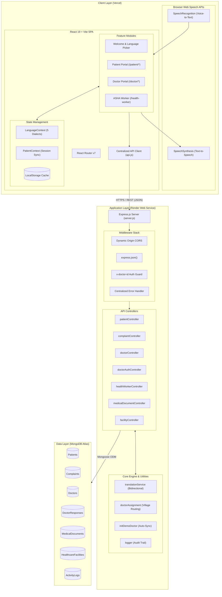
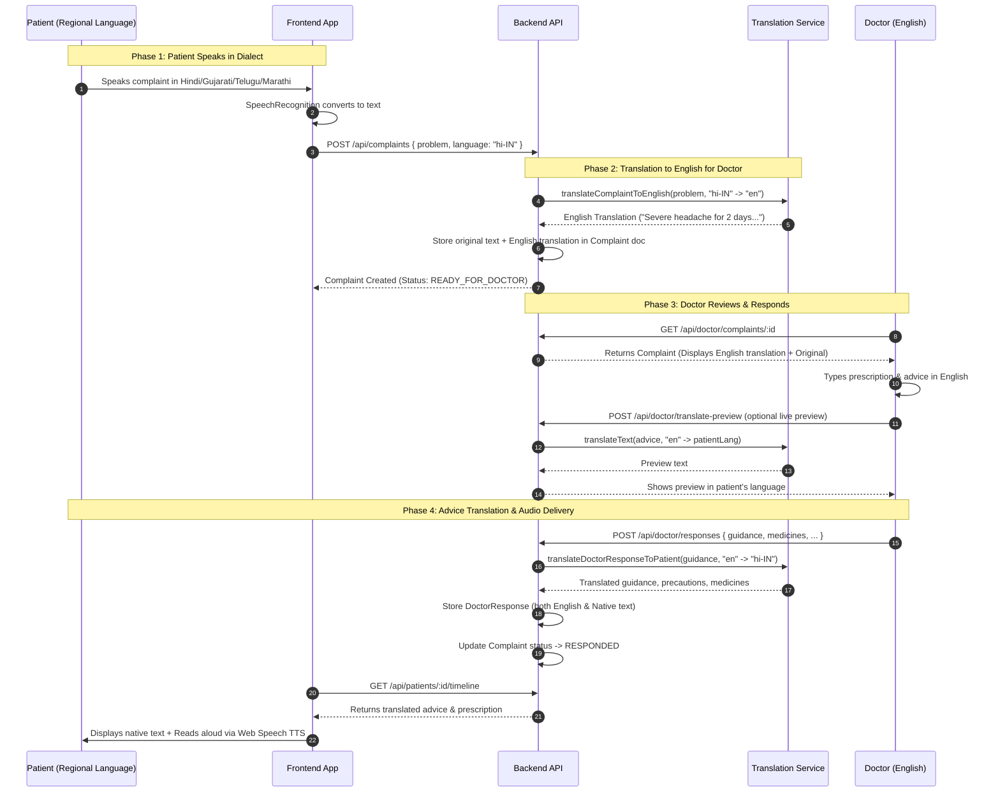
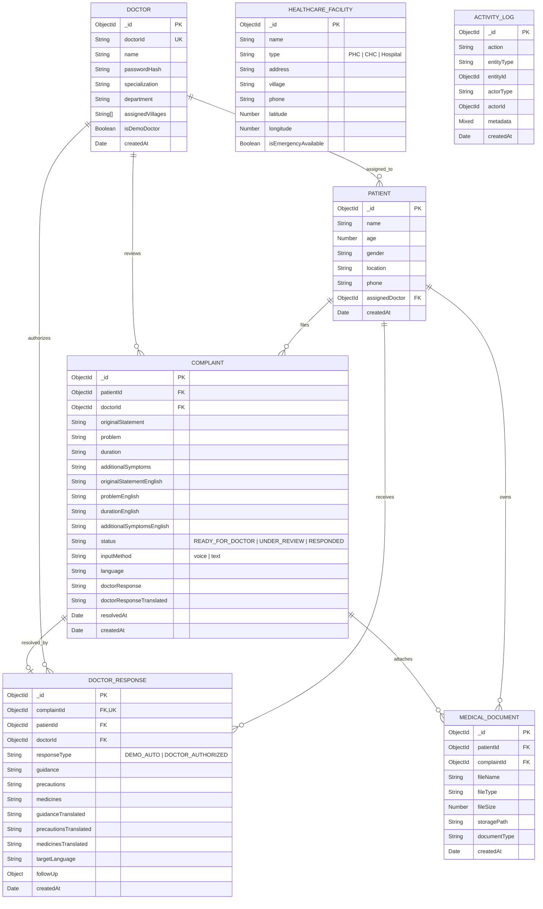
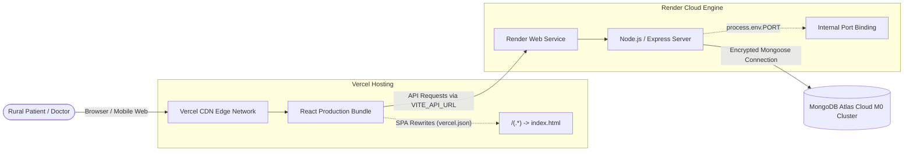

# SwasthyaSetu — System Architecture & Technical Design

## 1. Executive Summary & Purpose

**SwasthyaSetu** (स्वास्थ्यसेतु - *Bridge to Healthcare*) is an accessible, voice-first, multilingual rural telemedicine platform designed to connect underserved rural populations with licensed healthcare professionals. 

### Core Value Proposition
- **Voice-First Accessibility:** Overcomes literacy barriers by allowing rural patients to describe symptoms, register, and listen to medical guidance using native speech in regional Indian dialects.
- **Bidirectional Language Bridge:** Converts patient complaints from regional languages (Hindi, Gujarati, Telugu, Marathi) into English for doctors, and translates doctor prescriptions and advice back into the patient's native dialect.
- **Audio Feedback Loop:** Provides audible read-aloud playback of medical advice via Text-to-Speech (TTS), ensuring that patients who cannot read prescriptions still understand their treatment, dosage, and precautions.
- **Zero-Friction Doctor Queuing:** Delivers structured, triaged patient queues to doctors with automated village-level routing and live translation previews.

---

## 2. High-Level System Architecture

SwasthyaSetu follows a decoupled, **Client-Server 3-Tier Architecture** consisting of a React Single-Page Application (SPA) client, an Express.js REST API application server, and a cloud-hosted MongoDB Atlas NoSQL database.



---

## 3. Frontend Architecture (React SPA)

The frontend is built on **React 19**, bundled using **Vite 8**, and styled with **Tailwind CSS**.

### 3.1 Component & Page Organization
```
frontend/src/
├── assets/          # Brand logos, mobile/desktop hero assets
├── components/      # Atomic UI components (Button, VoiceButton, StatusBadge, ListenButton)
├── context/         # Cross-cutting state stores (LanguageContext, PatientContext)
├── data/            # Static dictionaries, conversation prompts, mock configurations
├── hooks/           # Web API abstraction hooks (useSpeechRecognition, useSpeechSynthesis)
├── layouts/         # Layout wrappers (PatientLayout with Bottom Navigation & Header)
├── pages/           # Screen controllers
│   ├── Welcome.jsx                  # Dialect selector & voice onboarding entrance
│   ├── PatientHome.jsx              # Active consultation status & health portal
│   ├── Register.jsx                 # Conversational entity-extraction voice intake
│   ├── Complaint.jsx                # Voice/text symptom description
│   ├── Advice.jsx                   # Doctor guidance playback & prescription viewer
│   ├── History.jsx                  # Chronological health record timeline
│   ├── Profile.jsx                  # Patient identification card
│   ├── doctor/                      # Doctor dashboard, queue & complaint detail
│   ├── healthWorker/                # Community healthcare overview & triage
│   └── patient/                     # Facilities locator, emergency dialer, documents
├── routes/          # AppRoutes.jsx (declarative URL routing)
└── services/        # api.js, conversationEngine.js, languageDetection.js
```

### 3.2 State Management & Persistence
The client purposely avoids heavy external state libraries (e.g., Redux) in favor of lightweight, predictable **React Context**:
- **`LanguageContext`**: Stores active language (`hi-IN`, `en-US`, `gu-IN`, `te-IN`, `mr-IN`), exposes translation function `t(key, params)`, and persists selection in `localStorage` under `swasthya_setu_language`.
- **`PatientContext`**: Maintains active patient record and active complaint. Synchronizes transparently with MongoDB upon initialization via `GET /api/patients/:id` and writes offline backups to `localStorage` (`swasthyasetu_patient`).
- **Doctor Session**: Managed via `localStorage` (`swasthya_doctor`) and forwarded automatically in HTTP request headers via `x-doctor-id`.

### 3.3 Voice & Conversational Engine
- **`useSpeechRecognition`**: Wraps native browser `SpeechRecognition` / `webkitSpeechRecognition`. Handles speech start, silence detection, interim stream vs. final transcripts, error recovery, and mic permission flags.
- **`conversationEngine.js`**: A rule-based conversational information extraction pipeline that parses unstructured speech transcripts into structured clinical and demographic fields:
  - Phone extraction (`/\d{10}/`)
  - Age extraction (`/([1-9][0-9]?|1[01][0-9]|120)/`)
  - Gender extraction: Evaluates female keywords prior to male keywords with word boundary matching (`\b(female|woman|girl)\b`, `महिला`, `स्त्री`) to eliminate substring collisions.
  - Location and Name sanitization with regional filler filtering.
- **`useSpeechSynthesis`**: Controls `window.speechSynthesis` and `SpeechSynthesisUtterance`. Dynamically maps regional voice targets and implements an `estimatedDuration` fallback timer to prevent silence lockups on mobile browsers where `onend` events fail to trigger.

---

## 4. Backend Architecture (Express REST API)

The backend is built with **Node.js** and **Express.js**, adhering to a layered **Controller-Service-Repository** pattern.

```
backend/
├── config/
│   └── db.js                        # Resilient Mongoose connection manager with Atlas fallback
├── controllers/
│   ├── patientController.js         # Patient creation, fetching, timeline aggregation
│   ├── complaintController.js       # Complaint submission, auto-translation, assignment
│   ├── doctorController.js          # Queue management, stats, review status, advice creation
│   ├── doctorAuthController.js      # Doctor authentication & identity verification
│   ├── healthWorkerController.js    # Community analytics and follow-up trackers
│   ├── medicalDocumentController.js # Medical report and prescription locker
│   └── facilityController.js        # Health center geographic directory
├── models/                          # Mongoose Schemas (7 core collections)
├── routes/                          # Express modular router mounting
├── utils/
│   ├── translationService.js        # Bidirectional translation engine
│   ├── doctorAssignment.js          # Village-based doctor allocation logic
│   ├── initDemoDoctor.js            # Self-healing demo doctor initialization
│   └── logger.js                    # System-wide audit activity logging
└── server.js                        # Application entry point, CORS & middleware
```

### 4.1 Server Middleware Pipeline
1. **Dynamic CORS (`corsOptions`)**: Supports environment-driven origins (`process.env.FRONTEND_URL`), wildcard Vercel deployment URLs (`*.vercel.app`), and local development environments (`localhost`).
2. **Body Parser**: Handles standard JSON payloads via `express.json()`.
3. **Doctor Authentication Guard (`protectDoctor`)**: Extracts the `x-doctor-id` header to associate clinical actions with active doctor accounts.
4. **Health Check & Diagnostics**:
   - `GET /`: Returns API operational status and version.
   - `GET /api/health`: Provides real-time MongoDB connectivity status (`connected` vs `disconnected`) and timestamp.
5. **Centralized Error Handler**: Formats Mongoose `ValidationError` and `CastError` into clean user-facing responses while suppressing stack traces in production (`NODE_ENV === 'production'`).

---

## 5. Bidirectional Translation Pipeline

A critical architectural pillar of SwasthyaSetu is bridging the language barrier between patients and medical professionals.



---

## 6. Database Schema & Data Models

SwasthyaSetu uses MongoDB with strict Mongoose schema validation.



---

## 7. API Route Architecture

| Method | Endpoint | Description | Access |
| :--- | :--- | :--- | :--- |
| **System** | | | |
| `GET` | `/` | Root API status verification | Public |
| `GET` | `/api/health` | Service health & MongoDB connection check | Public |
| **Patient API** | | | |
| `POST` | `/api/patients` | Register or update patient profile | Public |
| `GET` | `/api/patients/:id` | Fetch patient profile | Public |
| `PUT` | `/api/patients/:id` | Update patient record | Public |
| `GET` | `/api/patients/:patientId/doctor` | Retrieve patient's assigned doctor | Public |
| `GET` | `/api/patients/:patientId/timeline`| Aggregate chronological care timeline | Public |
| **Complaint API** | | | |
| `POST` | `/api/complaints` | Submit complaint (auto-translates to English) | Public |
| `GET` | `/api/complaints/:id` | Get specific complaint details | Public |
| `GET` | `/api/complaints/patient/:patientId` | Fetch all complaints for a patient | Public |
| **Doctor API** | | | |
| `POST` | `/api/doctor/login` | Doctor credential authentication | Public |
| `GET` | `/api/doctor/me` | Verify active doctor session | Doctor Header |
| `GET` | `/api/doctor/stats` | Consultation metrics (pending, under review, resolved) | Doctor Header |
| `GET` | `/api/doctor/complaints` | Filterable triage queue (status, search, sort) | Doctor Header |
| `PATCH`| `/api/doctor/complaints/:id/review`| Mark complaint as `UNDER_REVIEW` | Doctor Header |
| `POST` | `/api/doctor/translate-preview` | Live translation preview before submitting advice | Doctor Header |
| `POST` | `/api/doctor/responses` | Submit advice & prescription (auto-translates to native) | Doctor Header |
| `GET` | `/api/doctor/responses/complaint/:complaintId` | Fetch advice tied to a complaint | Doctor Header |
| `PUT` | `/api/doctor/responses/:id` | Edit previous clinical advice | Doctor Header |
| **Health Worker API** | | | |
| `GET` | `/api/health-worker/overview` | Village community summary metrics | Public |
| `GET` | `/api/health-worker/patients` | Community patient roster with latest status | Public |
| `GET` | `/api/health-worker/followups` | Pending medical follow-up appointments | Public |
| **Auxiliary Modules** | | | |
| `GET` | `/api/facilities` | Directory of nearby PHCs, CHCs, and hospitals | Public |
| `POST` | `/api/documents` | Upload report/prescription metadata | Public |
| `GET` | `/api/documents/patient/:patientId` | Get documents in patient's health locker | Public |

---

## 8. Deployment & Infrastructure Topology

SwasthyaSetu is optimized for cloud deployment across **Vercel**, **Render**, and **MongoDB Atlas**.



### 8.1 Environment Variable Matrix

| Variable Name | Environment | Purpose | Sensitivity |
| :--- | :--- | :--- | :--- |
| `VITE_API_URL` | **Vercel** (Frontend) | Target URL of backend API (e.g. `https://api.onrender.com/api`) | Public |
| `MONGODB_URI` | **Render** (Backend) | MongoDB Atlas connection URI with credentials | **Secret** |
| `FRONTEND_URL` | **Render** (Backend) | Production client origin for CORS header whitelisting | Config |
| `NODE_ENV` | **Render** (Backend) | Set to `production` to suppress debug errors | Config |
| `PORT` | **Render** (Backend) | Dynamic port assigned by Render runtime | Auto |

---

## 9. Architectural Qualities & Design Decisions

### 1. Zero-Install Mobile Web Strategy
- **Decision:** Built as a responsive web app using Vite + Tailwind instead of requiring a native mobile app download from Google Play.
- **Rationale:** Rural devices frequently have constrained internal storage, low RAM, and metered connectivity. A lightweight browser application loads instantly without app store friction.

### 2. Native Web Speech over Proprietary Cloud STT/TTS
- **Decision:** Leverage browser-native `SpeechRecognition` and `SpeechSynthesis`.
- **Rationale:** Eliminates recurrent per-minute paid cloud API costs (e.g., Google Cloud Speech / AWS Polly), making the solution cost-free and sustainable for rural public health setups.

### 3. Graceful Fallback Architecture
- **Decision:** Dual-mode input everywhere (voice or text).
- **Rationale:** If a device's microphone is faulty, ambient background noise is excessive, or browser permissions are rejected, the UI automatically transitions to simple manual selection forms (`MANUAL_FALLBACK`), ensuring users are never blocked.

### 4. Self-Healing Prototype Seeding
- **Decision:** Backend automatically creates a `DOC-DEMO-001` doctor record and mock healthcare facilities upon database connection if missing.
- **Rationale:** Guarantees zero-touch setup and ensures that every submitted complaint is immediately reviewable on the doctor dashboard without manual database migration steps.

---

## 10. Future Architectural Roadmap

1. **Edge LLM Integration**: Incorporate on-device or cloud LLMs for medical triage summarization and ICD-10 symptom categorization.
2. **WebSockets / Server-Sent Events (SSE)**: Replace REST polling with bidirectional real-time push events for instant consultation status updates.
3. **PWA & Offline Service Workers**: Cache application shells and queue voice recordings in IndexedDB when offline, syncing automatically when connectivity resumes.
4. **JWT & ABHA (Ayushman Bharat Digital Mission) Integration**: Upgrade prototype header authentication to secure JWT access tokens and national digital health ID (ABHA) standards.
